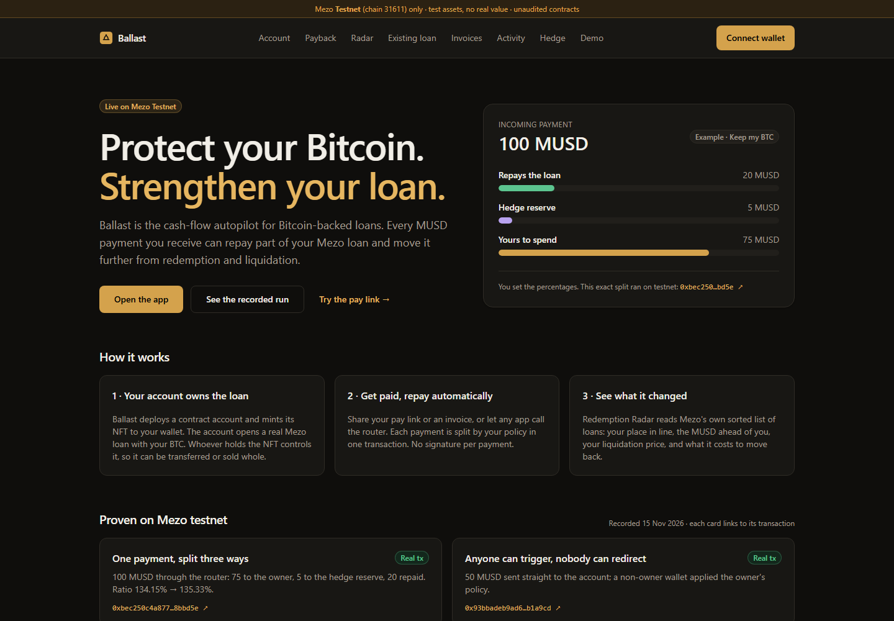
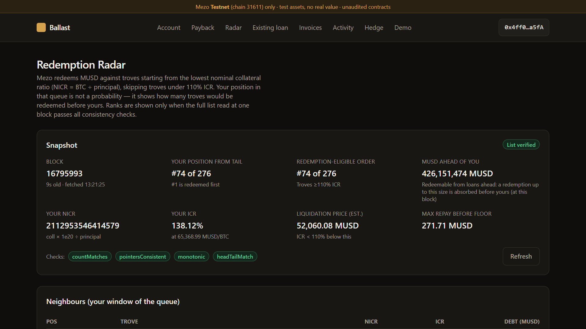
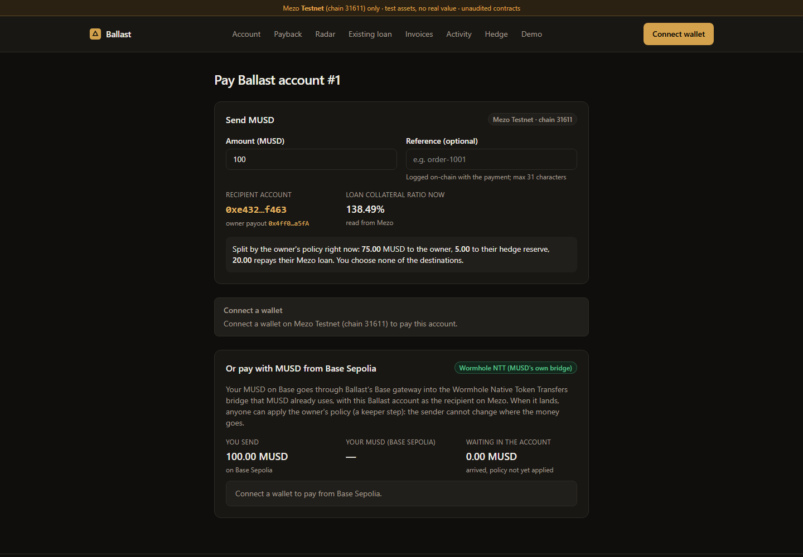
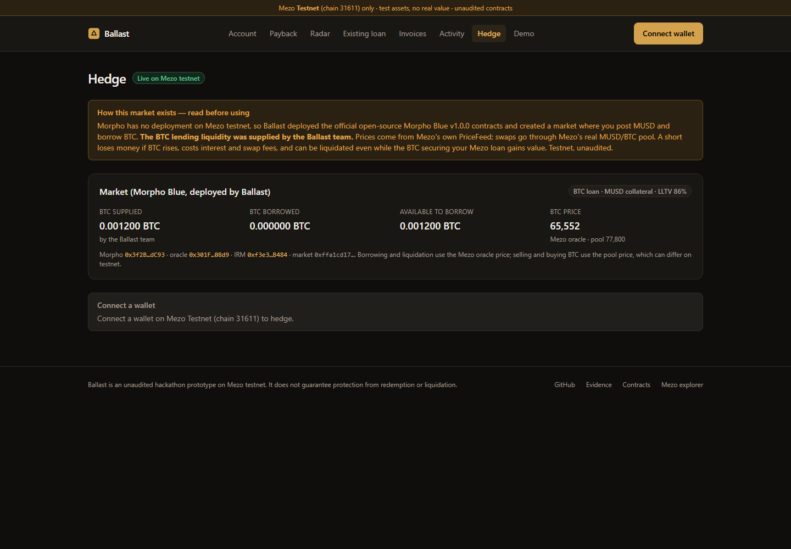
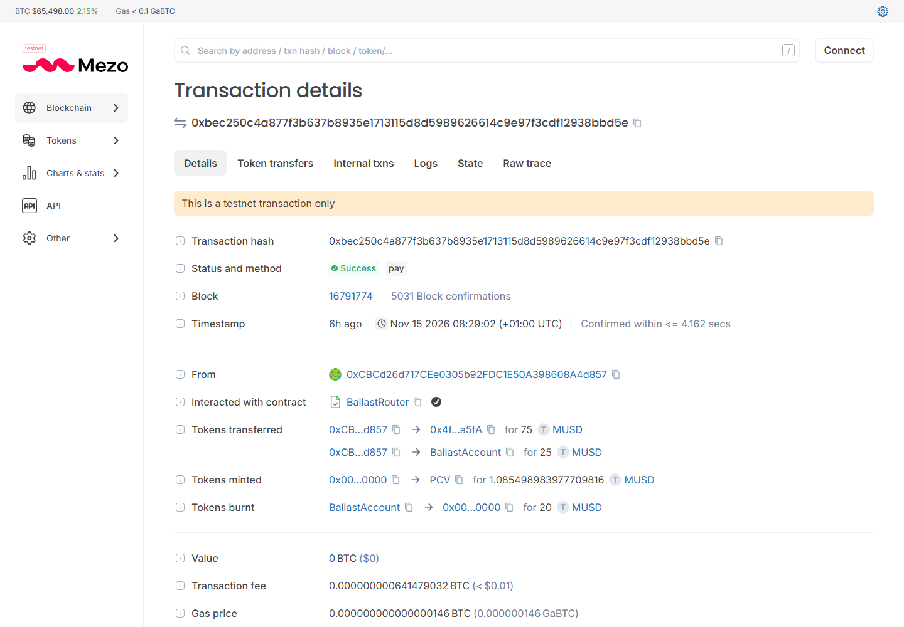
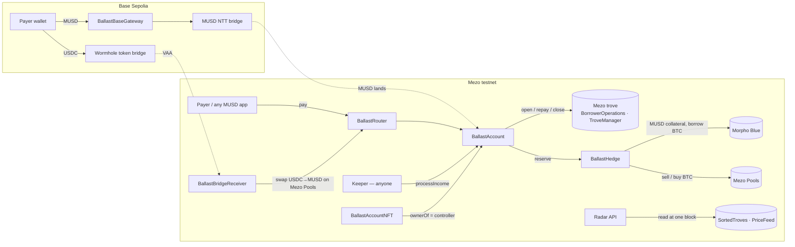

<div align="center">

# ⚓ Ballast

### The cash-flow autopilot for Bitcoin-backed loans

**Every MUSD payment you receive can make your Mezo loan safer — automatically.**

[](https://ballast-tawny.vercel.app)
[](https://explorer.test.mezo.org/address/0xe43257DB9B711c29A8e44c5C4F58950752FAf463)
[](#-tests)
[](docs/DEPLOYMENTS.md)

**Mezo Buildathon Wave 2** · Track 1: DeFi (primary) · Track 2: Access & Distribution

[Live app](https://ballast-tawny.vercel.app) · [Proof (tx links)](#-proof-every-claim-has-a-transaction) · [Architecture](#-architecture) · [Contracts](#-deployed-contracts) · [Run it](#-run-it-locally) · [Full description](docs/PROJECT_DESCRIPTION.md)



</div>

---

## 📌 TL;DR

| | |
|---|---|
| **What** | An NFT-controlled smart account that **owns a real Mezo MUSD loan** and splits every incoming payment by the owner's policy: part **repays the loan**, part funds an optional **BTC hedge**, the rest goes to the **owner**. |
| **Why** | Mezo borrowers lose BTC to **redemptions** (lowest-ratio loans first, even healthy ones) and **liquidations** (below 110%). Today they defend by hand, and the money they earn never touches the loan. |
| **How it's different** | Ballast acts on **income, before trouble**, and proves the effect in numbers: each payment emits the collateral ratio **before and after**, and the Radar shows your live place in Mezo's redemption line. |
| **Status** | **Live on Mezo testnet**: 9 contracts, all source-verified, no admin or upgrade keys. 53 Foundry tests (32 against live chain state). Every feature below has a real testnet transaction. |
| **Who** | BTC-holding merchants, freelancers and small companies paid in MUSD; and MUSD payment apps that integrate with **one call**: `BallastRouter.pay(accountId, amount, reference)`. |

---

## 🧭 The problem

A Mezo borrower can lose their position two ways, and guards against both manually:

| Risk | What happens | Today |
|---|---|---|
| **Redemption** | Any MUSD holder swaps MUSD for BTC at $1 (minus 0.75%). The BTC is taken from the **lowest-collateral-ratio loans first — even healthy ones.** | Borrower must watch the queue and repay by hand. |
| **Liquidation** | Below a **110%** collateral ratio the loan is closed and the collateral lost. | Borrower must watch the BTC price and top up by hand. |
| **Idle income** | MUSD the borrower earns sits in a wallet. | It never reduces the debt unless they move it themselves. |

## 💡 The solution

```
         payment (MUSD on Mezo · or from Base Sepolia over Wormhole)
                                │
                                ▼
                    ┌───────────────────────┐
                    │     BallastRouter      │  pay(accountId, amount, reference)
                    │  split by OWNER policy │  — payer chooses no destination
                    └───────────┬───────────┘
              ┌─────────────────┼──────────────────┐
              ▼                 ▼                  ▼
        20% repays the     5% hedge reserve    75% to the owner
        Mezo loan          (optional BTC        (payout wallet)
        (capped at Mezo's   short on Morpho)
        minimum debt)
              │
              ▼
   event: collateral ratio BEFORE → AFTER   +   Radar: new place in the redemption line
```

### Goal presets (every number editable)

| Preset | Repay | Hedge | To owner | Extra |
|---|---:|---:|---:|---|
| **Keep my BTC** | 20% | 5% | 75% | — |
| **Get out of debt** | 60% | — | 40% | — |
| **Keep cash available** | 10% | — | 90% | Minimum cash buffer: repayments wait until your wallet holds it |

---

## ✨ Features

| Feature | What it does | Status |
|---|---|---|
| 🏦 **Account owns the loan** | `BallastAccount` opens and owns a real Mezo trove with your BTC. An ERC-721 NFT is the key: whoever holds it controls everything. | ✅ Live |
| 💸 **Automatic split & repay** | One transaction: owner share, hedge reserve, and repayment of the account's own loan. No signature per payment. | ✅ Live |
| 📈 **Ratio before/after on-chain** | Every payment emits `Payment(…, icrBefore, icrAfter)` read from Mezo's own PriceFeed and TroveManager. | ✅ Live |
| 🤖 **Permissionless keeper** | MUSD that lands in the account directly (e.g. from a bridge) waits as income; **anyone** can call `processIncome` to apply the owner's policy. The caller can't redirect a cent. | ✅ Live |
| 🧱 **Minimum-debt cap** | Repayment stops at Mezo's minimum debt (≈2,000 MUSD); the excess goes to the owner instead of reverting. | ✅ Live |
| 🔗 **Pay link + router API** | `/pay/a/<accountId>` for anyone; `BallastRouter.pay(...)` for any MUSD app. | ✅ Live |
| 📡 **Redemption Radar** | Live from Mezo's sorted list at one block: position, MUSD ahead of you, MUSD to pass the next 1/10/50 loans, liquidation price, largest valid repayment, verified before/after. | ✅ Live |
| 🌉 **Pay from Base Sepolia** | USDC over Wormhole's token bridge → swapped to MUSD on Mezo → paid through the router, **in one Mezo transaction**. MUSD over its own Wormhole NTT bridge via `BallastBaseGateway` is deployed and tested. | ✅ USDC live · NTT built |
| 🛡️ **Optional BTC hedge** | The account posts MUSD from its hedge reserve on Morpho Blue, borrows BTC, sells it on Mezo Pools, and closes back into itself. | ✅ Live |
| 🔁 **Transferable / sellable account** | The NFT moves the whole account, open loan included, to a wallet or an NFT-ready escrow contract. | ✅ Live |
| ✍️ **Existing loans** | A loan held in a plain wallet can't move in, so Ballast uses Mezo's own **signed one-off repayment**. | ✅ Live |

<table>
<tr>
<td width="50%"><b>Redemption Radar</b> (live data, demo account)<br/></td>
<td width="50%"><b>Pay link</b>: live split and ratio<br/></td>
</tr>
<tr>
<td width="50%"><b>Hedge</b>: live Morpho Blue market<br/></td>
<td width="50%"><b>A real payment on the explorer</b>: 75 owner / 25 account / 20 MUSD repaid (burnt)<br/></td>
</tr>
</table>

---

## 🔍 Proof: every claim has a transaction

All on **Mezo testnet (chain 31611)**, current **v3** deployment unless noted. Every receipt has status 1. Full before/after reads and block numbers: [docs/TEST_EVIDENCE.md](docs/TEST_EVIDENCE.md).

| # | Claim | Result | Transaction |
|---|---|---|---|
| 1 | The account owns a real Mezo loan | Trove keyed by the account address | [openTrove](https://explorer.test.mezo.org/tx/0x1c12b684ebebac2154275e09462345386ee597cce37f7c4ad13b58fb62dee76e) |
| 2 | `pay()` splits and repays in one tx | 100 MUSD → **75 / 5 / 20**, ratio **134.15% → 135.33%** | [pay](https://explorer.test.mezo.org/tx/0xbec250c4a877f3b637b8935e1713115d8d5989626614c9e97f3cdf12938bbd5e) |
| 3 | A keeper applies the policy, can't redirect | 50 MUSD → 37.5 / 2.5 / 10, applied by a non-owner wallet | [processIncome](https://explorer.test.mezo.org/tx/0x93bbadeb9ad67c95f32ca5507ee6b7d9b28cec00d4c327dd857868aaf4b1a9cd) |
| 4 | Pay from Base Sepolia | USDC → Wormhole → MUSD → split + repay, one Mezo tx | [Base tx](https://base-sepolia.blockscout.com/tx/0x9cffb34e7c4173b809ece2f2258d9e15dad6283eaeb522f0d0a7d78746cd0c54) → [Mezo settle](https://explorer.test.mezo.org/tx/0x666b7277e706eef1044e650b138a68247d50e003bfb112758990578180b45c75) |
| 5 | Hedge opened and closed by the account | 80 MUSD posted, 0.0005 BTC borrowed + sold; cost 0.78 MUSD | [open](https://explorer.test.mezo.org/tx/0x09d17ce366ce7ef78439386f04b6238476f19d99a51a4a74651cf3c66c3cc447) · [close](https://explorer.test.mezo.org/tx/0xd6a52ed49876862609d15578cf56b51b5372a38a2f45065aa8337675363ded54) |
| 6 | Account sold whole, loan open | Listed in escrow, released to buyer | [list](https://explorer.test.mezo.org/tx/0x2d8e01521db67bb4542be4383d3f1a053f219c17a890c19f99995ccd630f857a) · [release](https://explorer.test.mezo.org/tx/0x43626e6369e6e8304ee33348492fe1b0c45f08333d404e8937a36bd5c208b8d9) |
| 7 | Repayment capped at minimum debt (v2) | Debt stops at the floor; excess paid to owner | [pay](https://explorer.test.mezo.org/tx/0xb52b86935a203d3fe55ed858d69bbefedb655703b43a1539e2108789dac098a0) |
| 8 | Existing wallet loan, signed one-off repay | 50 MUSD → 40 to borrower, **debt −10.000000** | [payDirectInvoice](https://explorer.test.mezo.org/tx/0x359ee97e8a6964e5354f55576bb667595de5e9f41f453b894d24df94b0462494) |
| 9 | Radar quote moves you in line (v1) | Quote 12.76 MUSD → repaid → position #165 → #166 | [repay](https://explorer.test.mezo.org/tx/0xea07e53b0a2664cffc796b8e1063c0174979068ef0f200ccd5d810c3bd798c75) |

---

## 🏗️ Architecture



| Contract | Role | Who can call what |
|---|---|---|
| `BallastFactory` | Deploys accounts, mints the NFT | Anyone creates their own account |
| `BallastAccountNFT` | ERC-721 key; transfer = hand over the account | Holder only; on transfer the payout address resets to the new holder |
| `BallastAccount` | Owns the trove; holds the policy, owner MUSD, hedge reserve | **NFT holder**: everything. **Router / keeper**: only apply the owner's stored policy to *incoming* MUSD |
| `BallastRouter` | `pay`, `payWithHints`, `payInvoice`; computes the split from account state | Anyone can pay; nobody chooses destinations |
| `BallastHedge` (+ factory) | Per-account Morpho short | The account and its NFT holder only |
| `BallastMezoOracle` | Mezo PriceFeed → Morpho's 1e36 price scale | Read-only |
| `BallastBridgeReceiver` | Redeems Wormhole USDC, swaps to MUSD, pays the invoice; refunds on any failure | Anyone may submit the VAA |
| `BallastBaseGateway` (Base Sepolia) | Sends MUSD over NTT to a Ballast account | Anyone |
| `BallastRepaymentAdapter` | Mezo signed one-off repayment for wallet-held loans | Anyone with the borrower's signature |

Deep dive: [docs/ARCHITECTURE.md](docs/ARCHITECTURE.md).

---

## 🟠 Mezo integration

| Mezo piece | How Ballast uses it |
|---|---|
| **MUSD loan contracts** (`BorrowerOperations`, `TroveManager`) | Open, own, repay, borrow, close a real loan *from the contract account*; `repayMUSDWithSignature` for wallet-held loans |
| **Sorted loan list** (`SortedTroves`, `HintHelpers`) | Live redemption-line reads; insert hints so repayments stay cheap |
| **PriceFeed** | Ratio before/after in every payment event; the hedge market's oracle |
| **Mezo Pools** | MUSD↔BTC swaps for the hedge; bridged USDC → MUSD |
| **Wormhole on Mezo testnet** | Token bridge (USDC) and MUSD's Native Token Transfers bridge from Base Sepolia |
| **MUSD** | The payment asset end to end — no wrapper |

---

## 📜 Deployed contracts

**Mezo testnet (chain 31611), v3** — all source-verified, no admin or upgrade keys. Full list with deploy transactions: [docs/DEPLOYMENTS.md](docs/DEPLOYMENTS.md).

| Contract | Address |
|---|---|
| BallastRouter | [`0xe10Bf81CdAEB11970377b2fD81fBb17B5AF36eed`](https://explorer.test.mezo.org/address/0xe10Bf81CdAEB11970377b2fD81fBb17B5AF36eed) |
| BallastFactory | [`0xa10B844dD88B1EE3cA896280A0A1E8F8d5Ed7514`](https://explorer.test.mezo.org/address/0xa10B844dD88B1EE3cA896280A0A1E8F8d5Ed7514) |
| BallastAccountNFT | [`0xfDacc99E2b6df2fB8427DDB520998A3117a29124`](https://explorer.test.mezo.org/address/0xfDacc99E2b6df2fB8427DDB520998A3117a29124) |
| BallastAccount #1 (demo, owns the loan) | [`0xe43257DB9B711c29A8e44c5C4F58950752FAf463`](https://explorer.test.mezo.org/address/0xe43257DB9B711c29A8e44c5C4F58950752FAf463) |
| BallastHedgeFactory | [`0x2A76297B8562D6380911fDa94f80c7D2bFCB6FD6`](https://explorer.test.mezo.org/address/0x2A76297B8562D6380911fDa94f80c7D2bFCB6FD6) |
| BallastHedge (account #1) | [`0x5bCB976EF92673ABbc564583155CdC0AC86846CC`](https://explorer.test.mezo.org/address/0x5bCB976EF92673ABbc564583155CdC0AC86846CC) |
| BallastBridgeReceiver | [`0x514EADC7013D1aFb276CfA783A71f2D175bc3104`](https://explorer.test.mezo.org/address/0x514EADC7013D1aFb276CfA783A71f2D175bc3104) |
| BallastRepaymentAdapter | [`0x096f8C705fce216bdBAEc7f86022117682A9f7DC`](https://explorer.test.mezo.org/address/0x096f8C705fce216bdBAEc7f86022117682A9f7DC) |
| BallastMezoOracle | [`0x301FEEf08C25D2F8AE5EfF95E8f32253006108d9`](https://explorer.test.mezo.org/address/0x301FEEf08C25D2F8AE5EfF95E8f32253006108d9) |
| Morpho Blue v1.0.0 (deployed by Ballast) | [`0x3f2Be2a4a16e3fbc55e168B6cC56AA46Ff9cdC93`](https://explorer.test.mezo.org/address/0x3f2Be2a4a16e3fbc55e168B6cC56AA46Ff9cdC93) |
| **Base Sepolia** · BallastBaseGateway | [`0x8Da29e84f88F35f87549b5d8a8EF54e4aD1c298C`](https://base-sepolia.blockscout.com/address/0x8Da29e84f88F35f87549b5d8a8EF54e4aD1c298C) |

Addresses in the app come only from [`config/deployments.mezo-testnet.json`](config/deployments.mezo-testnet.json).

---

## 🔐 Security model

- **One key:** only the current NFT holder (`ownerOf`, read live — never cached) can move collateral, withdraw MUSD, change policy or close the loan.
- **Payers and keepers can only give money.** The split and every destination come from the account's stored policy. The account books the owner's MUSD (`ownerMUSD`) separately from incoming income, so a keeper can never sweep the owner's funds into a repayment.
- **Atomic:** every leg of a payment succeeds or the whole transaction reverts. Bridge payments that can't complete are refunded to the payer on Mezo.
- **No admin, no upgrades, no fees.** Reentrancy guards on every state-changing entry; split conservation fuzz-tested; signed invoices bound to chain + router with replay and expiry checks.
- Threat model and residual risks: [docs/SECURITY.md](docs/SECURITY.md). **Unaudited.**

---

## 🧪 Tests

**53 Foundry tests** (21 unit/fuzz + 32 against live Mezo and Base Sepolia state) + 12 TypeScript maths tests.

```bash
forge build
forge test                                            # 21 unit/fuzz tests (fork suites skip without RPC)

scripts/fetch-morpho.sh                               # one-time: pinned Morpho Blue build for the hedge tests
export MEZO_TESTNET_RPC_URL=https://rpc.test.mezo.org
export BASE_SEPOLIA_RPC_URL=https://sepolia.base.org
forge test --match-contract BallastForkTest           # 5  · loan, pay, keeper, cap, transfer
forge test --match-contract BallastAdapterForkTest    # 8  · signed one-off repayment
forge test --match-contract BallastBridgeForkTest     # 7  · Base USDC → MUSD → invoice, refunds
forge test --match-contract BallastHedgeForkTest      # 8  · Morpho open/close, LLTV, liquidation
forge test --match-contract BallastBaseGatewayForkTest # 4 · MUSD over NTT from Base Sepolia

pnpm test && pnpm typecheck                           # 12 Radar maths tests + strict TypeScript
```

Run fork suites one at a time; together they overload the public RPC.

---

## 🚀 Run it locally

**Requirements:** Node 20+, pnpm 10, Foundry.

```bash
git clone https://github.com/Stella112/ballast && cd ballast
pnpm install
pnpm build && pnpm start        # http://localhost:3000
```

- Connect a wallet on **Mezo testnet** (chain 31611, RPC `https://rpc.test.mezo.org`); the app offers to add the network.
- Test BTC: https://faucet.test.mezo.org — a minimum loan needs ≈0.05 BTC.
- Step-by-step judge walkthrough: [docs/DEMO.md](docs/DEMO.md).
- Live runbook that broadcasts real testnet transactions (needs `.env.local` with disposable testnet keys): `BALLAST_LIVE=1 scripts/live.sh <command>`.

### Repository layout

```
contracts/src/      Solidity contracts (9)          contracts/test/   Foundry unit + fork tests
app/                Next.js App Router pages        lib/radar/        Redemption Radar read model + maths
components/         UI + wallet/tx components       scripts/live.sh   Live testnet runbook (evidence log)
config/             Verified deployment addresses   docs/             Evidence, security, architecture, demo
```

**Stack:** Solidity 0.8.24 · Foundry · OpenZeppelin 5 · Morpho Blue v1.0.0 · Next.js 15 · React 19 · TypeScript (strict) · wagmi · viem · Tailwind 4 · Vercel.

---

## ⚠️ Honest limitations

- **Testnet only, unaudited.** No guarantee against redemption or liquidation; queue position is a snapshot.
- **Created by Ballast because nothing existed on testnet** (disclosed in the app): the Morpho Blue deployment and its BTC liquidity; the USDC/MUSD pool on Mezo (small — a few MUSD per Base payment).
- The MUSD-over-NTT route from Base is deployed and tested; its live end-to-end run was waiting on a testnet guardian signature at submission. The USDC route is proven live.
- The hedge can lose money and be liquidated. Mezo's minimum loan is ≈2,000 MUSD. `pay()` without hints costs ≈4M gas on today's loan list — the app uses `payWithHints`.
- Demand is unproven: we don't yet know how many borrowers have regular MUSD income.

## 🗺️ Roadmap

| Milestone | Target |
|---|---|
| Audit-lite review and capped mainnet launch | Q1 2027 |
| Invoices as NFTs that feed the account + SDK for MUSD payment apps | Q1 2027 |
| Vault for BTC lenders on the hedge side, with a Mezo Earn gauge | Q2 2027 |

More: [docs/ROADMAP.md](docs/ROADMAP.md).

---

<div align="center">

**Team:** Maris — solo builder ([@Stella112](https://github.com/Stella112))

📚 [Project description](docs/PROJECT_DESCRIPTION.md) · [Test evidence](docs/TEST_EVIDENCE.md) · [Deployments](docs/DEPLOYMENTS.md) · [Security](docs/SECURITY.md) · [Verification log](docs/VERIFICATION.md) · [Submission copy](docs/AKINDO_SUBMISSION.md)

</div>
